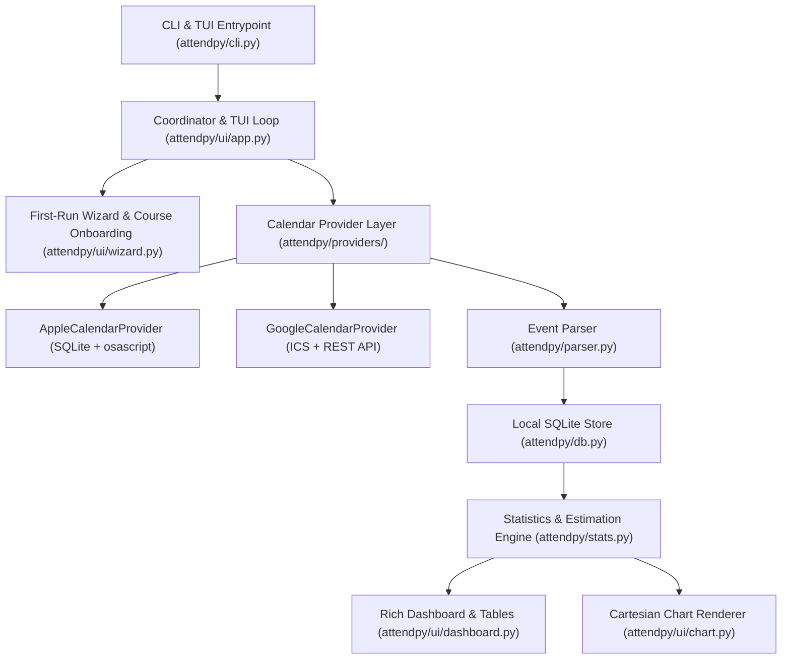

# `attendpy` — University Course Attendance Tracker

`attendpy` is a cross-platform Python CLI and Terminal User Interface (TUI) application that tracks university course attendance hours across **Theory** and **Laboratory** sessions. It integrates natively with **Apple Calendar** and **Google Calendar** using a **Two-Calendar Workflow** (*Attended Lessons* + *Skipped Lessons*), automatically detects new courses and newly completed lessons, estimates remaining semester hours and lessons, renders **Unicode Cartesian Attendance Charts**, and strictly follows **GNU Command-Line Standards** with a single external dependency (`rich`).

---

## Table of Contents

1. [Key Features](#1-key-features)
2. [System Architecture & Technical Documentation](#2-system-architecture--technical-documentation)
   - [2.1 High-Level Architecture](#21-high-level-architecture)
   - [2.2 The Two-Calendar Workflow Philosophy](#22-the-two-calendar-workflow-philosophy)
   - [2.3 Event Parsing & Theory vs. Laboratory Classification](#23-event-parsing--theory-vs-laboratory-classification)
   - [2.4 Mathematical Model & Estimations](#24-mathematical-model--estimations)
   - [2.5 Calendar Provider Subsystem](#25-calendar-provider-subsystem)
   - [2.6 Storage & Database Schema](#26-storage--database-schema)
3. [User Manual](#3-user-manual)
   - [3.1 Installation](#31-installation)
   - [3.2 First-Run Setup Wizard](#32-first-run-setup-wizard)
   - [3.3 Automatic Course Discovery](#33-automatic-course-discovery)
   - [3.4 Daily Usage & Interactive TUI](#34-daily-usage--interactive-tui)
   - [3.5 Skipping and Restoring Lessons](#35-skipping-and-restoring-lessons)
   - [3.6 GNU CLI Reference & Examples](#36-gnu-cli-reference--examples)
   - [3.7 Configuration Files & Environment Variables](#37-configuration-files--environment-variables)

---

## 1. Key Features

- **Two-Calendar Opt-Out Attendance Model:**
  - **Attended Calendar** (e.g., `"Lessons"`): Holds your scheduled university classes. Every completed lesson in this calendar is automatically counted as **Attended**—no tedious daily check-ins required.
  - **Skipped Calendar** (e.g., `"Skipped Lessons"`): Holds lessons you missed. Moving a lesson to this calendar (either from your calendar app or directly from `attendpy`'s UI/CLI) marks its hours as **Skipped**.
- **Automatic Calendar Verification & Creation:** On first connection (or via `--sync` / `--reconfigure`), `attendpy` checks whether both calendars exist in your calendar provider and **creates them automatically** if missing.
- **Hybrid Calendar Support:**
  - **Apple Calendar (`apple`):** Fast read-only access to macOS `Calendar.sqlitedb` + `osascript` bridge for creating calendars and moving events between categories. Automatically supports Google Calendar accounts synced into macOS Calendar.
  - **Google Calendar (`google`):** Direct support via RFC 5545 `.ics` feeds, local `.ics` stores, or Google Calendar REST API v3 using only Python's standard library (`urllib.request`).
  - **Hybrid Mode (`hybrid`):** Combines Apple Calendar and Google Calendar seamlessly.
- **Smart University Event Parser:** Recognizes university calendar descriptions such as:
  ```text
  Title: LINGUAGGI DI PROGRAMMAZIONE
  Description: LINGUAGGI DI PROGRAMMAZIONE- Aula Magna Matematica - Palazzo delle Scienze[ES_ID_SCIENZE_2_437_1495673]
  ```
  Automatically extracts the course name, classroom location, bracketed course ID (`[ES_ID_...]`), lesson duration in hours (`end_time - start_time`), and classifies the lesson as **Laboratory** (if `LABORATORIO`, `LABORATORY`, or `LAB` is present) or **Theory**.
- **Separate Theory & Laboratory Thresholds:** Tracks hours and thresholds independently for Theory (default **60%**) and Laboratory (default **80%**).
- **Incremental Schedule Estimations:** Designed for students who add lessons to their calendar week by week. Using the total semester hours configured per course, `attendpy` estimates remaining hours, remaining lessons, maximum achievable percentage, and how many hours/lessons you can still afford to skip.
- **Non-Blocking "Newly Completed Lessons" Banner:** On the first launch after lessons have finished, `attendpy` highlights them in a non-blocking banner so you can review what was automatically recorded and optionally skip any missed lesson in one step.
- **Rich TUI & Cartesian Attendance Charts:** Renders detailed tables, progress bars, status badges, and a **Cartesian coordinate plot** ($X = \text{Timeline}, Y = \text{Attendance \%}$) with Theory/Lab curves and dashed threshold lines.

---

## 2. System Architecture & Technical Documentation

### 2.1 High-Level Architecture



#### Directory Structure

```text
attendpy/
├── pyproject.toml               # Package metadata & single dependency (rich)
├── README.md                    # Architecture documentation & User Manual
├── attendpy/
│   ├── __init__.py              # Package version and metadata
│   ├── __main__.py              # Module entrypoint (python -m attendpy)
│   ├── cli.py                   # GNU-compliant CLI parser and usage()
│   ├── config.py                # JSON configuration management (~/.config/attendpy/config.json)
│   ├── db.py                    # SQLite database layer (~/.config/attendpy/attendpy.db)
│   ├── models.py                # Dataclasses: LessonEvent, CourseConfig, ComponentStats, CourseStats
│   ├── parser.py                # Title normalization, LABORATORIO detection, [ES_ID_...] extraction
│   ├── stats.py                 # Attendance math, remaining lesson estimator, time-series builder
│   ├── providers/
│   │   ├── __init__.py          # Provider factory & HybridCalendarProvider
│   │   ├── base.py              # Abstract CalendarProvider interface
│   │   ├── apple.py             # macOS Apple Calendar SQLite reader & AppleScript mutator
│   │   ├── google.py            # Google Calendar ICS & REST v3 provider
│   │   └── ics_parser.py        # Pure-stdlib RFC 5545 iCalendar (.ics) parser & generator
│   └── ui/
│       ├── __init__.py
│       ├── rich_compat.py       # Rich loader with pip._vendor.rich fallback
│       ├── app.py               # Main TUI loop and sync orchestrator
│       ├── wizard.py            # Step-by-step setup wizard and course discovery prompts
│       ├── dashboard.py         # Tables, progress bars, newly completed lessons banner
│       ├── chart.py             # Unicode Cartesian chart renderer
│       └── lessons.py           # Lesson list view and skip/restore handlers
└── tests/
    └── test_attendpy.py         # Automated unit and integration tests
```

---

### 2.2 The Two-Calendar Workflow Philosophy

Because university schedules are often added or updated week by week—and lessons may be rescheduled—`attendpy` recalculates statistics dynamically on every launch from two calendar categories:

1. **Attended Lessons Calendar (`attended_calendar`):**
   - Any event in this calendar with `end_time <= now` is automatically counted as **ATTENDED**.
   - Any event in this calendar with `end_time > now` is counted as **UPCOMING**.
2. **Skipped Lessons Calendar (`skipped_calendar`):**
   - Any event placed in this calendar is counted as **SKIPPED**.

**Why Two Calendars Matter for Accurate Math:**
If a course has $48\text{h}$ total Theory hours and the professor has delivered $20\text{h}$ so far—of which you attended $16\text{h}$ and skipped $4\text{h}$—simply deleting the $4\text{h}$ from your calendar would make it look as though only $16\text{h}$ have taken place and $32\text{h}$ remain in the semester (falsely reporting a $100\%$ maximum possible attendance). By moving missed lessons to the **Skipped Lessons** calendar (either in your calendar app or via `attendpy`), `attendpy` knows that $20\text{h}$ have been delivered, $28\text{h}$ remain, and your true maximum achievable attendance is $(16 + 28) / 48 = 91.7\%$.

---

### 2.3 Event Parsing & Theory vs. Laboratory Classification

Located in [`attendpy/parser.py`](file:///Users/andrea/Desktop/github/attendpy/attendpy/parser.py):

1. **Course Name Normalization (`normalize_course_name`):**
   - Strips bracketed IDs (`[ES_ID_...]`), removes trailing laboratory suffixes (`- Laboratorio`, `- Lab`), collapses whitespace, and normalizes to uppercase so Theory and Laboratory events map to the same parent course.
2. **Lesson Type Detection (`detect_lesson_type`):**
   - Evaluates a case-insensitive regular expression (default: `\b(LABORATORIO|LABORATORY|LAB)\b`) against both the event `SUMMARY` (title) and `DESCRIPTION`.
   - Matches are classified as `LessonType.LAB`; all other events default to `LessonType.THEORY`.
3. **Location & University ID Extraction (`extract_location`, `extract_external_code`):**
   - Extracts bracketed identifiers like `[ES_ID_SCIENZE_2_437_1495673]`.
   - Parses the classroom and building from the description (e.g., `Aula Magna Matematica - Palazzo delle Scienze`) when the calendar's `LOCATION` field is empty.
4. **Deterministic Lesson Identification (`compute_lesson_uid`):**
   - Generates a stable UID and an 8-character hexadecimal `short_id` (e.g., `b49b66af`) from `course_name + external_code/raw_uid + start_time`.

---

### 2.4 Mathematical Model & Estimations

Located in [`attendpy/stats.py`](file:///Users/andrea/Desktop/github/attendpy/attendpy/stats.py). For each component (**Theory** and **Laboratory**) of a tracked course:

- **Configured Total Semester Hours ($H_{\text{tot}}$):** Provided when onboarding the course (e.g., $48\text{h}$ Theory, $24\text{h}$ Lab).
- **Required Attendance Threshold ($T\%$):** Default $60\%$ for Theory, $80\%$ for Lab.
- **Required Hours ($H_{\text{req}}$):**
  $$H_{\text{req}} = \frac{T}{100} \times H_{\text{tot}}$$
- **Attended Hours ($H_{\text{att}}$):** Sum of `(end_time - start_time)` in hours for all past lessons in the Attended Calendar.
- **Skipped Hours ($H_{\text{skp}}$):** Sum of `(end_time - start_time)` in hours for all lessons in the Skipped Calendar (or marked skipped).
- **Delivered Hours ($H_{\text{del}}$):**
  $$H_{\text{del}} = H_{\text{att}} + H_{\text{skp}}$$
- **Estimated Remaining Hours ($H_{\text{rem}}$):**
  $$H_{\text{rem}} = \max(0, H_{\text{tot}} - H_{\text{del}})$$
- **Estimated Remaining Lessons ($L_{\text{rem}}$):**
  $$L_{\text{rem}} = \left\lceil \frac{H_{\text{rem}}}{\bar{d}} \right\rceil$$
  where $\bar{d}$ is the average lesson duration in hours for that component (defaulting to $2.0\text{h}$ if no lessons have occurred yet).
- **Current Attendance % (on delivered hours):**
  $$\text{Current \%} = \frac{H_{\text{att}}}{H_{\text{del}}} \times 100$$
- **Overall Progress % (towards total course hours):**
  $$\text{Progress \%} = \frac{H_{\text{att}}}{H_{\text{tot}}} \times 100$$
- **Maximum Possible Attendance % ($\text{Max \%}$):**
  $$\text{Max \%} = \frac{H_{\text{att}} + H_{\text{rem}}}{H_{\text{tot}}} \times 100$$
- **Skippable Hours & Lessons Left ($H_{\text{can\_skip}}, L_{\text{can\_skip}}$):**
  $$H_{\text{can\_skip}} = \max\left(0, (H_{\text{att}} + H_{\text{rem}}) - H_{\text{req}}\right), \quad L_{\text{can\_skip}} = \left\lfloor \frac{H_{\text{can\_skip}}}{\bar{d}} \right\rfloor$$

---

### 2.5 Calendar Provider Subsystem

Located in [`attendpy/providers/`](file:///Users/andrea/Desktop/github/attendpy/attendpy/providers/__init__.py):

- **`AppleCalendarProvider` (`apple.py`):**
  - Reads macOS Calendar's SQLite database (`~/Library/Group Containers/group.com.apple.calendar/Calendar.sqlitedb` or `~/Library/Calendars/Calendar.sqlitedb`) in immutable read-only mode (`?mode=ro`) for sub-millisecond queries.
  - Converts Apple CoreData timestamps (seconds since `2001-01-01 00:00:00 UTC`, offset `978307200`) to local time.
  - Uses `osascript` (AppleScript) to automatically create missing calendars (`make new calendar with properties {name:...}`) and to move events between the Attended and Skipped calendars.
  - Includes a local `.ics` directory fallback (`~/.config/attendpy/calendars/`) for non-macOS systems or headless environments.
- **`GoogleCalendarProvider` (`google.py`):**
  - Parses remote `https://` / `webcal://` iCalendar (`.ics`) feeds or local `.ics` files using the pure-stdlib RFC 5545 parser (`ics_parser.py`).
  - Supports Google Calendar REST API v3 via `urllib.request` when an OAuth bearer token JSON is configured.
- **`HybridCalendarProvider` (`__init__.py`):**
  - Queries both providers and merges events by deterministic UID.

---

### 2.6 Storage & Database Schema

Located in [`attendpy/db.py`](file:///Users/andrea/Desktop/github/attendpy/attendpy/db.py). `attendpy` stores its state in `~/.config/attendpy/`:

- `config.json`: Stores global settings (`provider`, `attended_calendar`, `skipped_calendar`, default thresholds, regex pattern, last sync timestamp).
- `attendpy.db`: SQLite database containing two tables:
  1. `courses`: Stores per-course settings (`name`, `tracked`, `theory_total_hours`, `theory_threshold_pct`, `has_lab`, `lab_total_hours`, `lab_threshold_pct`).
  2. `seen_lessons`: Tracks seen calendar lessons (`uid`, `short_id`, `raw_uid`, `course_name`, `start_time`, `end_time`, `lesson_type`, `calendar_name`, `status_override`, `acknowledged_completed`). The `acknowledged_completed` flag ensures that newly completed lessons are highlighted as **NEW** only on the first access after they finish.

---

## 3. User Manual

### 3.1 Installation

#### Requirements
- Python **3.10+**
- `rich` (automatically installed by `pip`, or falls back to `pip`'s bundled `rich` out of the box)

#### Install in Editable or User Mode
```bash
git clone <repository-url>
cd attendpy
pip install -e .
```

You can now run `attendpy` directly from your terminal (or via `python3 -m attendpy`).

---

### 3.2 First-Run Setup Wizard

When you run `attendpy` for the first time (or anytime with `attendpy --reconfigure`), an interactive step-by-step wizard launches:

1. **Step 1 — Select Calendar Provider:**
   - Choose `apple` (macOS Apple Calendar, including Google calendars synced to your Mac), `google` (direct `.ics` feed or OAuth token), or `hybrid`.
2. **Step 2 — Name Your Two Calendar Categories:**
   - **Attended Lessons Calendar Name:** Enter the name of the calendar where your university lessons are scheduled (e.g., `Lessons` or `Lezioni`).
   - **Skipped Lessons Calendar Name:** Enter the name of the calendar where skipped lessons will be stored (e.g., `Skipped Lessons` or `Lezioni saltate`).
3. **Step 3 — Automatic Verification & Creation:**
   - `attendpy` checks whether both calendars exist in your provider. If either calendar is missing, `attendpy` **creates it automatically** and confirms its status.

---

### 3.3 Automatic Course Discovery

Every time you launch `attendpy`, it scans your Attended and Skipped calendars. Whenever a new course title appears for the first time, `attendpy` displays a summary card and prompts you:

1. **Track this course?** (`[Y/n]`) — If you answer `n`, the course is added to the ignored list and hidden from statistics (you can re-enable it anytime via `--edit-course <NAME> --track`).
2. **Expected total Theory hours:** Enter the total Theory hours planned for the semester (e.g., `48`).
3. **Required Theory attendance threshold (%):** Press Enter to accept the default **`60%`** or enter a custom percentage.
4. **Does this course include Laboratory sessions?** (`[Y/n]`) — Automatically defaults to `Y` if events containing `LABORATORIO` were already found in your calendar.
5. **Expected total Laboratory hours & threshold (%):** Enter the total Lab hours (e.g., `24`) and threshold (default **`80%`**).

---

### 3.4 Daily Usage & Interactive TUI

Launch the interactive interface by running:

```bash
attendpy
```

#### What Happens on Launch:
1. **Live Recalculation:** All past lessons in your **Attended Calendar** are counted as attended; all lessons in your **Skipped Calendar** are counted as skipped. If a lesson was rescheduled or moved in your calendar, statistics update immediately.
2. **Non-Blocking Newly Completed Lessons Banner:** If one or more lessons finished since your last visit, a yellow notification panel at the top lists them. You do **not** have to confirm them—they are already counted as attended. If you missed any of them, press `n` in the menu to move them to your Skipped Calendar.
3. **Statistics Table & Cartesian Charts:** Displays the attendance table and a **Cartesian Attendance Chart** for each course showing your Theory curve (`●─●`), Lab curve (`◆═◆`), and horizontal threshold lines (`60%` and `80%`).
4. **Interactive Menu:**
   - `[d]` **Dashboard:** Refresh and display all visible course tables and Cartesian plots.
   - `[v]` **View Filter:** Choose which courses/exams are displayed or hidden in the Dashboard, and toggle Cartesian charts ON/OFF.
   - `[l]` **Lessons:** Inspect individual lessons (with Short ID, date, time, hours, Theory/Lab badge, status, and room/code).
   - `[s]` **Skip/Restore:** Enter one or more 8-character Lesson IDs to move a lesson to the Skipped Calendar (or restore it back to the Attended Calendar).
   - `[n]` **New Lessons:** Quickly skip any newly completed lesson from the current session.
   - `[c]` **Edit Courses:** Modify total hours, thresholds, Lab toggle, dashboard visibility, or tracking status for any course.
   - `[w]` **Wizard:** Re-run the step-by-step calendar provider and category configuration wizard.
   - `[r]` **Reset:** Factory reset all settings, courses, and lesson records.
   - `[q]` **Quit:** Exit `attendpy`.

---

### 3.5 Skipping and Restoring Lessons

You have **two ways** to mark a lesson as skipped, and both stay in sync:

1. **Directly in Apple Calendar / Google Calendar:**
   - Change the calendar category of the missed lesson from your *Attended Calendar* (e.g., `Lessons`) to your *Skipped Calendar* (e.g., `Skipped Lessons`). Next time you open `attendpy`, it detects the move automatically.
2. **From `attendpy` (TUI or CLI):**
   - In the TUI, press `[s]` (or `[n]` for newly completed lessons) and type the lesson's 8-character ID (e.g., `b49b66af`).
   - Or from the terminal CLI:
     ```bash
     # Move lesson b49b66af to Skipped Calendar
     attendpy --skip b49b66af

     # Restore lesson b49b66af back to Attended Calendar
     attendpy --restore b49b66af
     ```

---

### 3.6 GNU CLI Reference & Examples

`attendpy` provides a full set of GNU-style command-line flags so you can script, inspect, or reconfigure everything without opening the interactive TUI.

```text
Usage: attendpy [OPTION]...
Track university course attendance hours across Theory and Laboratory sessions
using a Two-Calendar workflow (Attended Calendar + Skipped Calendar) for
Apple Calendar and Google Calendar.

Calendar & Provider Configuration Options:
  -c, --attended-calendar=NAME   set the calendar category name for attended and
                                 scheduled lessons (e.g. "Lessons")
  -k, --skipped-calendar=NAME    set the calendar category name for skipped lessons
                                 (e.g. "Skipped Lessons")
  -p, --provider=TYPE            select calendar backend: 'apple', 'google', or 'hybrid'
      --google-attended-ics=URI  set Google Calendar .ics URL or file path for attended lessons
      --google-skipped-ics=URI   set Google Calendar .ics URL or file path for skipped lessons
      --lab-pattern=REGEX        set regex used to classify Laboratory lessons
                                 (default: '\b(LABORATORIO|LABORATORY|LAB)\b')
      --reconfigure              run the interactive step-by-step setup wizard
      --sync                     verify/create calendars and synchronize lessons now
      --reset                    factory reset: delete all saved configuration, courses,
                                 and lesson history to start from scratch
  -y, --yes                      automatic yes to confirmation prompts (e.g. with --reset)

Reporting & Inspection Options:
  -s, --stats[=COURSE]           display attendance statistics (and charts) and exit
      --no-chart                 omit Cartesian charts when running with --stats
      --chart[=COURSE]           display only the Cartesian attendance chart(s) and exit
  -l, --lessons[=COURSE]         list individual lessons with ID, date, time, hours,
                                 Theory/Lab classification, location, and status
      --new-lessons              list newly completed lessons since the last check
      --courses                  list all registered courses (tracked and ignored)
      --list-calendars           list all calendar categories available in the provider

Attendance & Course Modification Options:
  -x, --skip=LESSON_ID           mark lesson LESSON_ID as skipped and move it to the
      --cancel=LESSON_ID         Skipped Lessons calendar
  -r, --restore=LESSON_ID        restore skipped lesson LESSON_ID to attended and move
                                 it back to the Attended Lessons calendar
      --edit-course=COURSE       create or modify configuration for COURSE (combine with
                                 the course flags below)
      --theory-hours=HOURS       set total expected Theory hours (used with --edit-course)
      --theory-threshold=PCT     set Theory attendance threshold % (default: 60)
      --has-lab                  enable Laboratory tracking for the course
      --no-lab                   disable Laboratory tracking for the course
      --lab-hours=HOURS          set total expected Laboratory hours (used with --edit-course)
      --lab-threshold=PCT        set Laboratory attendance threshold % (default: 80)
      --track                    enable tracking for the course (un-ignore)
      --ignore                   ignore the course in attendance calculations
      --show-course=COURSE       show COURSE in the dashboard view
      --hide-course=COURSE       hide COURSE from the dashboard view (still tracked)

Miscellaneous Options:
  -h, --help                     display this help manual and exit
  -v, --version                  output version information and exit
```

#### Common CLI Examples

```bash
# 1. Configure Apple Calendar categories from CLI (creates them if missing)
attendpy -p apple -c "Lezioni" -k "Lezioni saltate" --sync

# 2. View full statistics dashboard and Cartesian charts for all courses
attendpy --stats

# 3. View only the Cartesian attendance chart for a specific course
attendpy --chart "LINGUAGGI DI PROGRAMMAZIONE"

# 4. List all individual lessons (with ID, date, time, hours, Theory/Lab, room)
attendpy --lessons "LINGUAGGI DI PROGRAMMAZIONE"

# 5. Skip a lesson by its 8-character ID
attendpy --skip b49b66af

# 6. Restore a skipped lesson back to Attended
attendpy --restore b49b66af

# 7. Configure or update a course's hours and thresholds from CLI
attendpy --edit-course "LINGUAGGI DI PROGRAMMAZIONE" \
  --theory-hours 48 --theory-threshold 60 \
  --has-lab --lab-hours 24 --lab-threshold 80

# 8. Factory reset everything (configuration, courses, and lesson history) to start from scratch
attendpy --reset
# Or skip confirmation prompt:
attendpy --reset -y
```

---

### 3.7 Configuration Files & Environment Variables

- **Default Directory:**
  - macOS / Linux: `~/.config/attendpy/` (or `$XDG_CONFIG_HOME/attendpy/`)
  - Windows: `%APPDATA%\attendpy\`
- **Custom Directory Override:**
  Set the `ATTENDPY_HOME` environment variable to point to any custom directory:
  ```bash
  export ATTENDPY_HOME="/path/to/custom/dir"
  attendpy --stats
  ```
